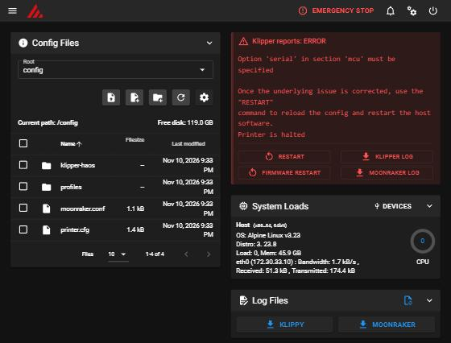

# Klipper HAOS

**Run Klipper, Moonraker and Mainsail directly on Home Assistant OS.**

Klipper HAOS is a Home Assistant app (formerly called an add-on). It turns
the machine that already runs Home Assistant OS into a 3D printer host, with
no Raspberry Pi, no second operating system, no virtual machine and no
unmanaged Docker containers. The Home Assistant Supervisor installs,
updates, backs up and supervises it like any other app.

> **Status: experimental (v0.1.0).** The app is built and tested
> automatically in containers, but it has **not yet been validated on a real
> Home Assistant OS installation or on real printer hardware**. Read
> [Known limitations](#known-limitations) before using it with a printer.



*Screenshot from the automated test environment (simulated ingress proxy,
no printer connected). Klipper correctly reports that no serial device is
configured yet.*

## Features

* Klipper host software, Moonraker API server and Mainsail web interface in
  one app, supervised by s6-overlay.
* Mainsail in the Home Assistant sidebar through **Ingress**: no extra port,
  no extra login, Home Assistant authentication.
* Optional **direct port** (7125) for slicers such as OrcaSlicer and for
  other Moonraker clients. It is disabled by default and needs a Moonraker
  API key.
* Persistent configuration, G-code files, print history and Moonraker
  database. They survive restarts, updates and container recreation and are
  included in Home Assistant backups.
* **Safe first start.** The generated `printer.cfg` defines no motion and no
  heaters until you choose a printer profile.
* **Ender 3 V3 SE profile** with a hardware validation checklist and a print
  safety gate.
* Reproducible **MCU firmware builds** that match the bundled Klipper
  version exactly. Firmware is never flashed automatically.
* Pinned and verified upstream versions. Releases are published to GHCR
  with immutable version tags.
* Small footprint: about **55 MiB RAM** for all services when idle (measured
  in the test container, see [test report](docs/test-report.md)).

## Status

| Area | Status |
|---|---|
| Image build (amd64), all services start, start-up order, health check | **Tested** (automated, containers) |
| Ingress: Mainsail UI, Moonraker API, WebSocket, 24 MiB upload | **Tested** against a simulated Supervisor ingress proxy |
| Direct port: API key auth, header spoofing protection, CORS | **Tested** (automated) |
| Persistence across restarts, crash-loop protection, graceful stop | **Tested** (automated) |
| Ender 3 V3 SE profile: syntax and pins against the compiled MCU dictionary | **Tested** (Klipper batch mode) |
| Installation from the app store on real Home Assistant OS | **Not yet tested** |
| Ingress through the real Home Assistant frontend and Supervisor | **Not yet tested** |
| Home Assistant backup and restore, app updates | **Not yet tested** |
| USB serial connection to a real printer | **Not yet tested** |
| Ender 3 V3 SE on real hardware (motion, heaters, probe, printing) | **Not yet tested** |
| aarch64 (Raspberry Pi, ODROID, Green, Yellow) | **Planned** |
| Original Creality display, pressure-sensor Z-offset, camera, timelapse | **Planned / not supported** |

## Requirements

* Home Assistant OS with a current Supervisor. The app uses the 2026
  "apps" manifest format (for example the `app_config` folder mapping).
* An **amd64 (x86-64)** host. The initial target is an Intel Celeron laptop
  with 4 GB RAM.
* About **400 MB of disk** for the image, plus space for G-code files.
* A printer whose controller board can run Klipper firmware and connects
  over USB.

## Installation

1. In Home Assistant open **Settings → Apps → App store** (older versions
   call it the Add-on store). Open the top-right menu, choose
   **Repositories**, and add:

   ```
   https://github.com/OWNER/klipper-haos
   ```

2. Install the **Klipper** app. Do not start it yet.
3. On the **Configuration** tab, leave `serial_device` empty for now.
4. Start the app and open Mainsail from the sidebar. Klipper will report
   that no serial device is configured. This is expected.
5. Continue with [printer setup](docs/printer-setup.md). It covers
   identifying the board, building and flashing Klipper firmware, choosing
   the serial device and loading a printer profile.

Full instructions are in [docs/installation.md](docs/installation.md).

## Configuration

| Option | Default | Purpose |
|---|---|---|
| `serial_device` | *(empty)* | Printer serial port. Pick the `/dev/serial/by-id/...` entry. |
| `log_level` | `info` | Verbosity of the app's own messages (`debug` also makes Moonraker verbose). |
| `trusted_networks` | `[]` | CIDRs allowed to use the direct port without an API key. Unsafe ranges are rejected. |
| `cors_domains` | `[]` | Extra browser origins allowed to call Moonraker on the direct port. |
| `export_api_key` | `false` | Writes the Moonraker API key to `moonraker.apikey` in the app config folder, for slicers. |

To enable the direct port for slicers, go to the app's **Network** section
and set a host port for `7125/tcp`. See
[docs/installation.md](docs/installation.md#connecting-a-slicer).

## Architecture

```
 Browser ──HA login──► Home Assistant ──► Supervisor ingress (172.30.32.2)
                                                   │
                                     ┌─────────────▼──────────────── app container ──┐
 Slicer ──API key──► host:7125 ─────►│ nginx :8099 (ingress only) / :7125 (direct)  │
                                     │   ├─ Mainsail static files                    │
                                     │   └─ proxy ─► Moonraker 127.0.0.1:7126         │
                                     │                 └─ unix socket ─► Klipper      │
                                     │                                     └─ USB ─────┼─► printer MCU
                                     └───────────────────────────────────────────────┘
 /config (app config folder): printer.cfg, moonraker.conf, profiles/
 /data/printer_data:          gcodes, database, logs, backup
```

Details: [docs/architecture.md](docs/architecture.md).

## Backup and restore

The app uses **hot** backups, so a scheduled Home Assistant backup does not
stop a running print. Before each backup a hook asks Moonraker for a
consistent database snapshot. Logs are excluded. To restore, restore the app
from a Home Assistant backup as usual. See
[docs/backup-and-restore.md](docs/backup-and-restore.md).

## Uninstallation

Uninstalling the app removes its container and `/data` (G-code files,
history, database). The app config folder (`printer.cfg` and friends)
remains on the host under `/addon_configs/<id>_klipper` unless you delete
it. Make a backup first if you want to keep your files. Klipper firmware on
the printer is not touched. To go back to the stock firmware, see
[printer setup → recovery](docs/printer-setup.md#7-recovery-and-reverting-to-stock-firmware).

## Known limitations

* **Not validated on real HAOS or real printers yet.** Everything marked
  "not yet tested" above is unverified.
* **A host restart interrupts a running print.** Klipper runs on the Home
  Assistant machine. Rebooting or updating Home Assistant OS, restarting or
  updating this app, or a host crash all end the current print. Klipper's
  MCU safety timeouts turn the heaters off when the host stops responding.
  Print resume after a host interruption is **not** supported. Disable
  automatic updates for this app and avoid host updates during prints.
* Moonraker's own update manager is disabled. Components are updated only
  through app releases.
* Moonraker system actions (reboot or shut down the host, restart services)
  are not available from Mainsail. Use Home Assistant to restart the app.
* No webcam, timelapse, or AI failure detection in this release.
* The original Creality display and the Ender 3 V3 SE pressure-sensor
  Z-offset are not supported. Use Mainsail and the CR Touch.
* Services run as root inside the container. A custom AppArmor profile is
  not shipped yet.

## Roadmap

See the milestones in [docs/roadmap.md](docs/roadmap.md): hardware
validation (v0.2), integration and reliability (v0.3), stable (v1.0).
aarch64 support and further printer profiles are planned. Contributions are
welcome.

## Troubleshooting

See [docs/troubleshooting.md](docs/troubleshooting.md).

## Contributing

Contributions are welcome: printer profiles, architecture support, testing
on real hardware and documentation. Read [CONTRIBUTING.md](CONTRIBUTING.md)
and [docs/development.md](docs/development.md). Please report security
issues privately as described in [SECURITY.md](SECURITY.md).

## License

The project's own code and documentation are released under the
[MIT License](LICENSE). The app image bundles GPL-3.0 software (Klipper,
Moonraker, Mainsail) and other third-party components under their own
licenses; see [THIRD_PARTY_NOTICES.md](THIRD_PARTY_NOTICES.md). This is an
independent community project, not affiliated with the Klipper, Moonraker,
Mainsail, Creality or Home Assistant projects.
